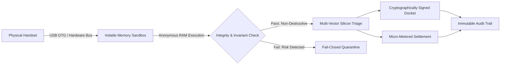

<!-- HEADER -->

  

<!-- TYPING ANIMATION -->

  

  

  

<!-- META BADGES -->

  
  &nbsp;
  
  &nbsp;
  
  &nbsp;
  
  &nbsp;
  
  &nbsp;
  

 

---

<!-- ABOUT / WHO I AM -->

  

  I'm a systems architect and embedded software engineer who works at the edges — the parts of systems that break, get abused, or get ignored. 
  Security tooling, mobile money fraud detection, low-level Linux/POSIX sandboxing, air-gapped cryptographic protocols, and things that must work even when power flickers and the internet goes dark.

  <em>Kenya-based. Thinking in distributed state machines and physical silicon. Building for the real world.</em>

<table align="center">
  <tr>
    <td align="center" width="820">
       
      &ldquo;<strong>The most dangerous assumption in software is that the happy path is the only path.</strong>&rdquo;
        
    </td>
  </tr>
</table>

 

<!-- ENGINEERING PRINCIPLES -->
<table align="center" width="820">
  <tr>
    <td align="center" width="273">
      <strong>🎯 Security by Design</strong> 
      Not an afterthought layer. Threat-model the failure modes first, write code second.
    </td>
    <td align="center" width="273">
      <strong>📡 Instrument Everything</strong> 
      If a subsystem can fail silently, it will. Telemetry and forensic auditability are load-bearing.
    </td>
    <td align="center" width="273">
      <strong>⚡ Resilience as Default</strong> 
      Happy paths are easy. Edge cases, dropped packets, and hostile physical environments are where real systems live.
    </td>
  </tr>
</table>

 

---

<!-- CORE VENTURE -->

  

### **Silicon Oath**
#### *Mobile-Hosted Hardware Diagnostics & Sovereign Trust Infrastructure*
Proprietary Fleet Infrastructure • Private Deployment • Nairobi, Kenya

<table align="center" width="840">
  <tr>
    <td>
      

        Across emerging markets, 500,000+ independent repair technicians keep hundreds of millions of smartphones alive, but are held back by expensive, proprietary desktop equipment and cracked foreign software that frequently compromises customer privacy and wipes user data.
      

      

        <strong>Silicon Oath</strong> replaces bulky $600 desktop repair rigs with an air-gapped mobile diagnostic cyberdeck running directly on standard Android smartphones technicians already carry:
      

      <ul>
        <li><strong>Volatile In-Memory Execution</strong>: Runs in rootless POSIX userland with anonymous RAM sealing, ensuring customer photos, banking keys, and personal data leave zero forensic footprint on local storage.</li>
        <li><strong>Air-Gapped Asymmetric Delegation</strong>: Hierarchical Ed25519 cryptographic token mesh enables offline provisioning, lease management, and anti-tamper ledgers across disconnected field nodes.</li>
        <li><strong>Fractional Micro-Metering</strong>: Native integration with African mobile money rails (M-PESA), aligning operating costs with daily diagnostic volume via prepaid burn-on-run architecture.</li>
        <li><strong>Hardware &amp; Data Invariants</strong>: Programmatic enforcement of data preservation and strict hardware fuse integrity across retail silicon.</li>
        <li><strong>Frontier Collateral Defense</strong>: Automated asset lien detection protecting informal technicians from handling encumbered or flagged devices.</li>
      </ul>
      

        
        &nbsp;
        
        &nbsp;
        
      

    </td>
  </tr>
</table>

 

---

<!-- SELECTED PUBLIC WORK -->

  

<table align="center" width="840">
  <tr>
    <td width="420" valign="top">
      <h3><a href="https://github.com/DANIELKILONZI/Mobile-Money-Fraud-DNA-System">💸 Mobile Money Fraud DNA System</a></h3>
      
Heuristic anomaly detection and forensic signature decomposition for high-throughput mobile money transaction graphs (M-PESA, Airtel Money). Separates synthetic fraud velocity from authentic informal market trade.

      

        
        
        
      

      🔍 Explainable signals · 🛡️ Synthetic identity detection
    </td>
    <td width="420" valign="top">
      <h3><a href="https://github.com/DANIELKILONZI/Offline-First-Internet-Layer">🌐 Offline-First Internet Layer</a></h3>
      
Resilient store-and-forward peer-to-peer transport protocol engineered for ultra-high-latency, intermittent cellular environments and off-grid African communities.

      

        
        
        
      

      📡 Zero-dependency · 🛰️ Opportunistic sync
    </td>
  </tr>
  <tr>
    <td width="420" valign="top">
      <h3><a href="https://github.com/DANIELKILONZI/Human-Readable-Binary-Protocol">📦 Human-Readable Binary Protocol</a></h3>
      
Deterministic network serialization engine with self-describing framing. Combines the packing efficiency of binary wire formats with zero-overhead Wireshark dissection and human inspectability.

      

        
        
        
      

      ⚡ Zero-copy · 🔬 Fuzz-tested parsing
    </td>
    <td width="420" valign="top">
      <h3><a href="https://github.com/DANIELKILONZI/EMP-Hardened-RF-Spectrum-Monitor-for-Critical-Infra">📻 EMP-Hardened RF Spectrum Monitor</a></h3>
      
Hardware-level radio frequency boundary telemetry and anomalous spectral shift detector designed to monitor critical telecommunications infrastructure under hostile interference.

      

        
        
        
      

      📡 Boundary telemetry · ⚡ Surge resilience
    </td>
  </tr>
  <tr>
    <td width="420" valign="top">
      <h3><a href="https://github.com/DANIELKILONZI/Living-Network-Stack">🧬 Living Network Stack</a></h3>
      
Adaptive network protocol architecture with dynamic layer reconfiguration and self-healing packet topologies for volatile distributed nodes.

      

        
        
      

      🛰️ Adaptive routing · 🛡️ Fault tolerance
    </td>
    <td width="420" valign="top">
      <h3><a href="https://github.com/DANIELKILONZI/Protocol-Virtual-Machine">⚙️ Protocol Virtual Machine</a></h3>
      
Deterministic sandboxed execution substrate for stateful protocol logic, custom wire framing, and declarative packet evaluation.

      

        
        
      

      🔬 Bytecode engine · 🔒 Isolated execution
    </td>
  </tr>
</table>

 

---

<!-- DOMAINS & STACK -->

  

| Domain | Core Primitives &amp; Technologies | What I Actually Do With It |
|:---|:---|:---|
| **Low-Level Systems &amp; OS** | `C (C99)` · `POSIX Shell` · `Linux Memory Sealing` · `AOT Binaries` · `Android sysfs` · `ARM64` | In-memory execution, process containment, rootless sandboxing, hardware register triage |
| **Applied Cryptography** | `Ed25519 (RFC 8032)` · `SHA-256 Hash Chains` · `Asymmetric Delegation` · `Monotonic Clocks` | Air-gapped voucher meshes, tamper-evident issuance logs, anti-replay, boot-anchored integrity |
| **Distributed Architecture** | `Python 3 (Asyncio)` · `Go` · `Rust` · `SQLite WAL` · `Kafka` · `ZeroMQ` | Store-and-forward networks, offline data reconciliation, event-driven ledger sync |
| **Fintech &amp; Telecommunications** | `Safaricom Daraja API` · `AT / QMI Modem Protocols` · `Collateral Forensics` | Autonomous micro-billing, carrier boundary analysis, asset lien forensics |

 

---

<!-- SYSTEM THINKING MAP -->

  

  <em>From raw hardware telemetry to immutable cryptographic ledgers — closed-loop sovereign computing.</em>

 

---

<!-- OUTSIDE THE TERMINAL -->

  

<table align="center" width="820">
  <tr>
    <td align="center" width="164">
      <strong>📚 Reading</strong>  
      Security engineering papers, distributed systems research, and the occasional philosophy of mind rabbit hole.
    </td>
    <td align="center" width="164">
      <strong>♟️ Chess</strong>  
      Positional player. Losing to engines since forever. The endgame is always the honest part of the board.
    </td>
    <td align="center" width="164">
      <strong>🏙️ Nairobi</strong>  
      Wired in from EAT (GMT+3). Shipping things while the rest of the world is still asleep.
    </td>
    <td align="center" width="164">
      <strong>🔧 Hardware Tinkering</strong>  
      Microcontrollers, custom circuits, and things that blink. Software is always more fun when it touches metal.
    </td>
    <td align="center" width="164">
      <strong>🎵 Focus OS</strong>  
      Lo-fi when designing. Drum &amp; bass when debugging. Total silence when writing critical security logic.
    </td>
  </tr>
</table>

 
  

 

---

<!-- HOW I LIKE TO COLLABORATE -->

  

<table align="center" width="820">
  <tr>
    <td align="center" width="273">
      <strong>1. Define the risk first</strong> 
      Before writing a single line of architecture, agree on what can fail, what matters most, and what cannot be compromised.
    </td>
    <td align="center" width="273">
      <strong>2. Ship the smallest real thing</strong> 
      I prefer thin, verifiable slices with telemetry over massive prototypes that teach nothing about production failure modes.
    </td>
    <td align="center" width="273">
      <strong>3. Keep the system legible</strong> 
      Clear contracts, explicit interfaces, and incident-friendly designs beat clever magic every single day.
    </td>
  </tr>
</table>

 

---

<!-- STATS & ACTIVITY -->

  

  

  
  &nbsp;
  

<!-- CONTRIBUTION SNAKE -->

  <picture>
    <source media="(prefers-color-scheme: dark)" srcset="https://raw.githubusercontent.com/DANIELKILONZI/DANIELKILONZI/output/github-snake-dark.svg"/>
    <source media="(prefers-color-scheme: light)" srcset="https://raw.githubusercontent.com/DANIELKILONZI/DANIELKILONZI/output/github-snake.svg"/>
    
  </picture>

 

---

<!-- GET IN TOUCH / FOOTER -->

  

  Open to conversations with systems engineers, founders, and teams tackling hard security, low-level Linux, or distributed problems. 
  <strong>Focus areas:</strong> Embedded systems &amp; POSIX userland · Applied cryptography · Frontier fintech &amp; fraud infrastructure

  
  &nbsp;
  
  &nbsp;
  

  Response time: usually within 24h · Nairobi, Kenya (GMT+3) · dnlkilonzi@gmail.com

  

