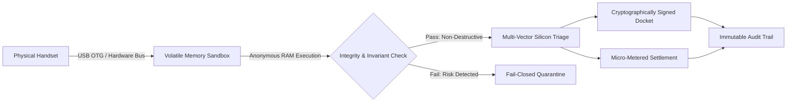

<!-- HEADER -->

  

<!-- TYPING ANIMATION -->

  

  

  

<!-- META BADGES -->

  
  &nbsp;
  
  &nbsp;
  
  &nbsp;
  
  &nbsp;
  

 

---

<!-- EXECUTIVE SUMMARY / BIO -->

  

  I am a systems architect, embedded Linux engineer, and founder based in <strong>Nairobi, Kenya</strong>. 
  I build where low-level silicon boundaries, distributed cryptography, and emerging-market economics collide.

<table align="center">
  <tr>
    <td align="center" width="820">
       
      &ldquo;<strong>Happy paths are cheap. Production systems are defined by how they fail under intermittent power, zero connectivity, and adversarial ground constraints.</strong>&rdquo;
        
    </td>
  </tr>
</table>

 

<table align="center" width="820">
  <tr>
    <td align="center" width="273">
      <strong>🔬 Deep Silicon &amp; POSIX</strong> 
      Anonymous memory sealing, AOT ARM64 compilation, and kernel-level hardware telemetry on constrained devices.
    </td>
    <td align="center" width="273">
      <strong>🔐 Applied Cryptography</strong> 
      Air-gapped asymmetric token delegation, boot-anchored monotonic clocks, and hash-chained audit ledgers.
    </td>
    <td align="center" width="273">
      <strong>💸 Frontier Fintech &amp; Defense</strong> 
      Autonomous mobile-money micro-settlement, asset lien detection, and statutory data protection compliance.
    </td>
  </tr>
</table>

 

---

<!-- VENTURE FOCUS (NO REPO LEAKS / TRADE SECRETS PROTECTED) -->

  

### **Silicon Oath**
#### *Mobile-Hosted Hardware Diagnostics & Cryptographic Trust Substrate*
Proprietary Fleet Infrastructure • Private Deployment

<table align="center" width="840">
  <tr>
    <td>
      

        Across emerging markets, 500,000+ independent repair technicians keep hundreds of millions of smartphones alive, but rely on expensive, proprietary desktop equipment and cracked foreign software that frequently compromises customer privacy and wipes user data.
      

      

        <strong>Silicon Oath</strong> replaces tethered desktop repair setups with an air-gapped mobile diagnostic cyberdeck running on smartphones technicians already own:
      

      <ul>
        <li><strong>Zero Forensic Disk Footprint</strong>: Executes diagnostic payloads entirely in volatile kernel memory, ensuring customer PII and sensitive data leave no traces on local flash storage.</li>
        <li><strong>Air-Gapped Delegated Trust Mesh</strong>: Hierarchical public-key cryptography enables offline provisioning, lease issuance, and tamper-evident auditing across disconnected field nodes.</li>
        <li><strong>Fractional Micro-Metering</strong>: Real-time unit economics integrated directly with African mobile money rails, aligning operational costs with daily diagnostic volume.</li>
        <li><strong>Hardware &amp; Data Invariants</strong>: Programmatic enforcement of data preservation and strict hardware fuse integrity across all supported silicon architectures.</li>
        <li><strong>Asset Lien Forensics</strong>: Automated collateral detection protecting independent technicians from handling encumbered or flagged devices in informal markets.</li>
      </ul>
      

        
        &nbsp;
        
        &nbsp;
        
      

    </td>
  </tr>
</table>

 

---

<!-- SELECTED PUBLIC OPEN SOURCE WORK -->

  

<table align="center" width="840">
  <tr>
    <td width="420" valign="top">
      <h3><a href="https://github.com/DANIELKILONZI/Mobile-Money-Fraud-DNA-System">💸 Mobile Money Fraud DNA System</a></h3>
      
Heuristic anomaly detection and forensic signature decomposition for high-throughput mobile money transaction graphs (M-PESA, Airtel Money). Distinguishes synthetic fraud velocity from authentic informal market trade.

      

        
        
        
      

      🔍 Explainable signals · 🛡️ Synthetic identity detection
    </td>
    <td width="420" valign="top">
      <h3><a href="https://github.com/DANIELKILONZI/Offline-First-Internet-Layer">🌐 Offline-First Internet Layer</a></h3>
      
Resilient store-and-forward peer-to-peer transport protocol engineered for ultra-high-latency, intermittent cellular connections and off-grid African rural communities.

      

        
        
        
      

      📡 Zero-dependency · 🛰️ Opportunistic sync
    </td>
  </tr>
  <tr>
    <td width="420" valign="top">
      <h3><a href="https://github.com/DANIELKILONZI/Human-Readable-Binary-Protocol">📦 Human-Readable Binary Protocol</a></h3>
      
Deterministic network serialization engine with self-describing framing. Delivers the packing efficiency of binary wire protocols with zero-overhead dissection and human readability.

      

        
        
        
      

      ⚡ Zero-copy · 🔬 Fuzz-tested parsing
    </td>
    <td width="420" valign="top">
      <h3><a href="https://github.com/DANIELKILONZI/EMP-Hardened-RF-Spectrum-Monitor-for-Critical-Infra">📻 EMP-Hardened RF Spectrum Monitor</a></h3>
      
Hardware-level radio frequency boundary telemetry and anomalous spectral shift detector designed to monitor critical telecommunication infrastructure under hostile conditions.

      

        
        
        
      

      📡 Boundary telemetry · ⚡ Surge resilience
    </td>
  </tr>
</table>

 

---

<!-- CURATED SYSTEMS STACK -->

  

| Domain | Core Technologies &amp; Primitives | Focus &amp; Practical Experience |
|:---|:---|:---|
| **Low-Level Systems &amp; OS** | `C` · `POSIX Shell` · `Linux Memory Sealing` · `AOT Binaries` · `Android sysfs` · `ARM64` | In-memory execution, process containment, rootless sandboxing, hardware telemetry |
| **Applied Cryptography** | `Ed25519` · `SHA-256 Hash Chains` · `Asymmetric Key Delegation` | Air-gapped voucher tokens, monotonic boot clocks, tamper-evident audit logs, anti-replay |
| **Distributed Architecture** | `Python 3` · `Go` · `Rust` · `SQLite WAL` · `Kafka` · `ZeroMQ` | Store-and-forward networks, offline data reconciliation, event-driven settlement |
| **Fintech &amp; Telecommunications** | `Mobile Money APIs` · `Modem AT / QMI Protocols` · `Collateral Verification` | Autonomous micro-billing, carrier boundary analysis, collateral lien detection |

 

---

<!-- ARCHITECTURE / SYSTEM THINKING MAP -->

  

  <em>From raw hardware telemetry to immutable cryptographic ledgers — closed-loop sovereign computing.</em>

 

---

<!-- STATS & CONTRIBUTION ACTIVITY -->

  

  

  
  &nbsp;
  

<!-- CONTRIBUTION SNAKE -->

  <picture>
    <source media="(prefers-color-scheme: dark)" srcset="https://raw.githubusercontent.com/DANIELKILONZI/DANIELKILONZI/output/github-snake-dark.svg"/>
    <source media="(prefers-color-scheme: light)" srcset="https://raw.githubusercontent.com/DANIELKILONZI/DANIELKILONZI/output/github-snake.svg"/>
    
  </picture>

 

---

<!-- GET IN TOUCH / FOOTER -->

  

  Open to conversations with founders, systems engineers, venture partners, and hardware researchers. 
  <strong>Focus areas:</strong> Low-level Linux/Android systems · Applied cryptography · Frontier fintech &amp; fraud infrastructure

  
  &nbsp;
  
  &nbsp;
  

  Nairobi, Kenya (GMT+3) · PGP Available on Request · dnlkilonzi@gmail.com

  

