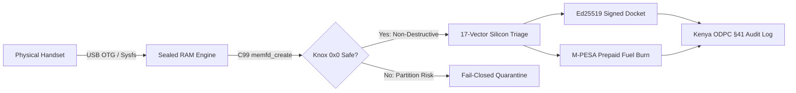

<!-- HEADER -->

  

<!-- TYPING ANIMATION -->

  

  

  

<!-- META BADGES -->

  
  &nbsp;
  
  &nbsp;
  
  &nbsp;
  
  &nbsp;
  

 

---

<!-- EXECUTIVE SUMMARY / BIO -->

  

  I am a systems architect, embedded Linux engineer, and founder based in <strong>Nairobi, Kenya</strong>. 
  I build where low-level silicon boundaries, distributed cryptography, and emerging-market economics collide.

<table align="center">
  <tr>
    <td align="center" width="820">
       
      &ldquo;<strong>Happy paths are cheap. Production systems are defined by how they fail under intermittent power, zero connectivity, and adversarial ground constraints.</strong>&rdquo;
        
    </td>
  </tr>
</table>

 

<table align="center" width="820">
  <tr>
    <td align="center" width="273">
      <strong>🔬 Deep Silicon &amp; POSIX</strong> 
      Anonymous RAM sealing via <code>memfd_create</code>, AOT ARM64 compilation, and Android sysfs telemetry without root.
    </td>
    <td align="center" width="273">
      <strong>🔐 Applied Cryptography</strong> 
      Air-gapped Ed25519 token delegation, monotonic boot-anchored clocks, and SHA-256 hash-chained audit ledgers.
    </td>
    <td align="center" width="273">
      <strong>💸 Frontier Fintech &amp; Defense</strong> 
      Autonomous M-PESA Daraja settlement, PayGo lien forensics (M-KOPA, Watu), and statutory safe-harbor compliance.
    </td>
  </tr>
</table>

 

---

<!-- FLAGSHIP VENTURE -->

  

### **[Silicon Oath / Pulsewave Core](https://github.com/DANIELKILONZI/pulsewave-core)**
#### *The World’s First Sovereign Mobile Diagnostic Cyberdeck & Cryptographic Repair Operating System*

<table align="center" width="840">
  <tr>
    <td>
      

        Across emerging markets, 500,000+ independent repair technicians are held hostage by proprietary, malware-ridden Windows dongle cartels (Chimera, Octoplus, Z3X) that cost hundreds of dollars, require desktop PCs, and routinely wipe customer data.
      

      

        <strong>Silicon Oath</strong> replaces the entire $600 desktop repair rig with an open, sovereign cyberdeck running on a <strong>$50 smartphone</strong> that the technician already carries in their pocket:
      

      <ul>
        <li><strong>Zero Forensic Disk Footprint</strong>: C99 engine executes diagnostic payloads in anonymous kernel RAM (<code>memfd_create</code>) sealed with <code>F_SEAL_GROW | F_SEAL_WRITE | F_SEAL_SEAL</code>. Customer photos, banking tokens, and PII vanish on process termination.</li>
        <li><strong>Air-Gapped Ed25519 Token Mesh</strong>: Master technicians mint compact URL-safe vouchers (<code>SO-V1-...</code>) with device caps and validity windows, claimed offline over SMS or printed QR without internet.</li>
        <li><strong>Prepaid Fuel Metering (KPLC Model)</strong>: Fractional micro-billing via Safaricom M-PESA Daraja at KES 25/run. Burn-on-run architecture eliminates post-repair cash bypass.</li>
        <li><strong>Hardware Invariants</strong>: Programmatic enforcement of <strong>0% Customer Data Loss</strong> and <strong>Samsung Knox 0x0 fuse preservation</strong>.</li>
        <li><strong>PayGo Collateral Defense</strong>: Deep-scans device partitions for active asset financing locks (M-KOPA, Watu Simu, D.light), protecting technicians under Kenya Penal Code §322.</li>
      </ul>
      

        
        &nbsp;
        
        &nbsp;
        
      

    </td>
  </tr>
</table>

 

---

<!-- SELECTED OPEN SOURCE WORK -->

  

<table align="center" width="840">
  <tr>
    <td width="420" valign="top">
      <h3><a href="https://github.com/DANIELKILONZI/Mobile-Money-Fraud-DNA-System">💸 Mobile Money Fraud DNA System</a></h3>
      
Heuristic anomaly detection and forensic signature decomposition for high-throughput mobile money transaction graphs (M-PESA, Airtel Money). Distinguishes synthetic fraud velocity from authentic informal market trade.

      

        
        
        
      

      🔍 Explainable signals · 🛡️ Synthetic identity detection
    </td>
    <td width="420" valign="top">
      <h3><a href="https://github.com/DANIELKILONZI/Offline-First-Internet-Layer">🌐 Offline-First Internet Layer</a></h3>
      
Resilient store-and-forward peer-to-peer transport protocol engineered for ultra-high-latency, intermittent cellular connections and off-grid African rural communities.

      

        
        
        
      

      📡 Zero-dependency · 🛰️ Opportunistic sync
    </td>
  </tr>
  <tr>
    <td width="420" valign="top">
      <h3><a href="https://github.com/DANIELKILONZI/Human-Readable-Binary-Protocol">📦 Human-Readable Binary Protocol</a></h3>
      
Deterministic network serialization engine with self-describing framing. Delivers the packing efficiency of binary wire protocols with zero-overhead Wireshark dissection and human readability.

      

        
        
        
      

      ⚡ Zero-copy · 🔬 Fuzz-tested parsing
    </td>
    <td width="420" valign="top">
      <h3><a href="https://github.com/DANIELKILONZI/EMP-Hardened-RF-Spectrum-Monitor-for-Critical-Infra">📻 EMP-Hardened RF Spectrum Monitor</a></h3>
      
Hardware-level radio frequency boundary telemetry and anomalous spectral shift detector designed to monitor critical telecommunication infrastructure under hostile conditions.

      

        
        
        
      

      📡 Boundary telemetry · ⚡ Surge resilience
    </td>
  </tr>
</table>

 

---

<!-- CURATED SYSTEMS STACK -->

  

| Domain | Core Technologies &amp; Primitives | Focus &amp; Practical Experience |
|:---|:---|:---|
| **Low-Level Systems &amp; OS** | `C99` · `POSIX Bash` · `Linux Kernel memfd` · `AOT ELF` · `Android sysfs` · `ARM64` | In-memory execution, process sealing, Android rootless sandbox, sysfs hardware telemetry |
| **Applied Cryptography** | `Ed25519 (RFC 8032)` · `SHA-256 Hash Chains` · `Asymmetric Key Delegation` | Air-gapped voucher tokens, monotonic boot clocks, tamper-evident audit logs, anti-replay |
| **Distributed Architecture** | `Python 3 (Asyncio)` · `Go` · `Rust` · `SQLite WAL` · `Kafka` · `ZeroMQ` | Store-and-forward networks, offline data reconciliation, event-driven settlement |
| **Fintech &amp; Telecommunications** | `Safaricom M-PESA Daraja (C2B / STK)` · `QMI / AT Modem Commands` · `PayGo MDM` | Autonomous micro-billing, carrier boundary analysis, collateral lien detection |

 

---

<!-- ARCHITECTURE / SYSTEM THINKING MAP -->

  

  <em>From raw silicon registers to immutable cryptographic ledgers — closed-loop sovereign computing.</em>

 

---

<!-- STATS & CONTRIBUTION ACTIVITY -->

  

  

  
  &nbsp;
  

<!-- CONTRIBUTION SNAKE -->

  <picture>
    <source media="(prefers-color-scheme: dark)" srcset="https://raw.githubusercontent.com/DANIELKILONZI/DANIELKILONZI/output/github-snake-dark.svg"/>
    <source media="(prefers-color-scheme: light)" srcset="https://raw.githubusercontent.com/DANIELKILONZI/DANIELKILONZI/output/github-snake.svg"/>
    
  </picture>

 

---

<!-- GET IN TOUCH / FOOTER -->

  

  Open to conversations with founders, distributed systems engineers, venture partners, and hardware researchers. 
  <strong>Focus areas:</strong> Low-level Linux/Android systems · Applied cryptography · Frontier fintech &amp; fraud infrastructure

  
  &nbsp;
  
  &nbsp;
  

  Nairobi, Kenya (GMT+3) · PGP Available on Request · dnlkilonzi@gmail.com

  

